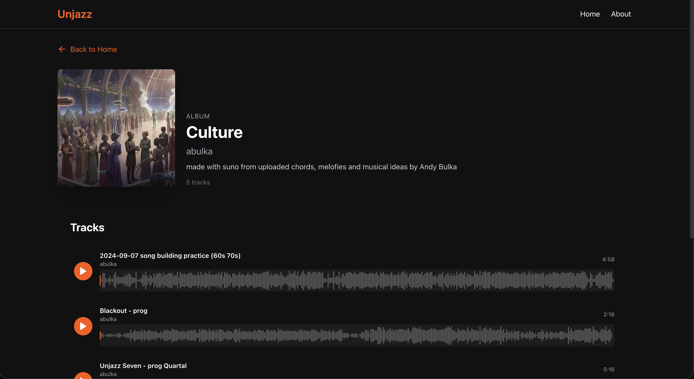

# Unjazz 🎵

Andy Bulka's (Unjazz) musical compositions

[Unjazz Website](https://abulka.github.io/unjazz).

# Summary

To host my music, I built a React-based music streaming platform. It features a SoundCloud-inspired UI, high-quality audio playback with Howler.js, and seamless integration with GitHub Releases for audio hosting. The site is deployed on GitHub Pages for easy access and low cost.

## Screenshot



## ✨ Features

- 🎨 **SoundCloud-style UI** with waveform visualizations
- 🎵 **High-quality audio playback** using Howler.js
- 📱 **Media Session API** integration (lock screen controls, AirPlay, CarPlay)
- 🎯 **Responsive design** for desktop and mobile
- ⚡ **Fast loading** with pre-generated waveforms
- 🎼 **Album organization** with automatic metadata extraction
- 🔊 **Playlist support** with continuous playback
- ⌨️ **Keyboard shortcuts** for playback control

## 🏗️ Architecture

### Hosting Strategy

**Audio Files:** Hosted on GitHub Releases (unlimited bandwidth for public repos)
- Upload MP3s as release assets
- No Git LFS bandwidth limitations
- 2GB per file limit

**Website:** GitHub Pages
- Static React application
- Vite build optimization
- Metadata stored in repository

### Folder Structure

```
unjazz/
├── public/
│   ├── albums/              # Local albums (not committed)
│   │   ├── album-name/
│   │   │   ├── track1.mp3
│   │   │   ├── track2.mp3
│   │   │   └── cover.jpg
│   └── metadata/            # Generated metadata (committed)
│       ├── tracks.json      # Track listing with URLs
│       ├── waveforms.json   # All waveforms
│       └── waveforms/       # Individual waveform files
├── src/
│   ├── components/          # React components
│   ├── context/             # Player state management
│   ├── pages/               # Route pages
│   └── App.jsx
├── scripts/
│   └── generate-manifest.js # Metadata generator
└── .github/workflows/
    └── deploy.yml           # CI/CD pipeline
```

## 🍏 Safari Compatibility (CORS Proxy)

Safari has strict requirements for audio streaming (CORS and Range headers) that GitHub Releases doesn't always satisfy by default. To fix this, we use a **Cloudflare Worker Proxy**.

- **Why?** Without it, Safari may throw "Media cannot be played" or fail to seek because of missing CORS origin or partial content headers.
- **Solution:** A tiny middleware that forwards the request from Safari to GitHub with the correct headers.
- **Setup:** Follow the [Introduction](cloudflare-worker/README.md) and [Quick Start Guide](cloudflare-worker/QUICKSTART.md) in the `cloudflare-worker/` directory for the worker script and step-by-step deployment instructions.

## 🚀 Quick Start

### Prerequisites

- Node.js 20+
- npm or yarn
- Optional: `audiowaveform` CLI for better waveform generation

```bash
# Install audiowaveform (optional but recommended)
# macOS
brew install audiowaveform

# Ubuntu/Debian
sudo apt-get install audiowaveform
```

### Installation

```bash
# Install dependencies
npm install

# Start development server
npm run dev

# Start development server with network access (for testing on iPhone)
npm run dev:host
```

## 📱 Testing on iPhone

To test the mobile experience on your physical iPhone while developing:

1.  **Start the host server:**
    Run `npm run dev:host`.
2.  **Find your IP address:**
    Vite will display a URL like `http://192.168.1.XX:5173/unjazz/`.
3.  **Connect:**
    Ensure your iPhone is on the same Wi-Fi network as your Mac, then open that URL in Safari.

## 📝 Adding Music

### Method 1: Local Development (Simple)

For local testing without uploading to GitHub, set `USE_GITHUB_RELEASES=false` in `.env`. The generate script will skip all GitHub API calls and build local URLs instead.

```bash
# .env
USE_GITHUB_RELEASES=false
```

1. **Add audio files to album folder (mp3 or m4a):**
   ```bash
   mkdir -p public/albums/summer-vibes
   cp your-track.mp3 public/albums/summer-vibes/
   cp cover.jpg public/albums/summer-vibes/
   ```

   > **Suno downloads:** Suno's default `.m4a` is Opus-in-MP4, which Safari/iOS cannot play. `npm run generate` detects and skips these. Use the `.wav` that Suno also downloads and encode it to AAC m4a (or mp3) first — see [DEVELOPER.md](DEVELOPER.md#m4a-aac-support).

2. **Generate metadata:**
   ```bash
   npm run generate
   ```

3. **Preview locally:**
   ```bash
   npm run dev
   ```

### Method 2: GitHub Releases (Production)

1. **Configure environment variables:**
   ```bash
   # Create .env file
   GITHUB_TOKEN=your_github_token
   GITHUB_REPO=username/unjazz-audio
   USE_GITHUB_RELEASES=true
   RELEASE_TAG=v1.0
   ```

2. **Add music and generate:**
   ```bash
   npm run generate
   # Uploads MP3s to GitHub Release automatically
   ```

3. **Commit and deploy:**
   ```bash
   git add public/metadata/
   git commit -m "Add new album"
   git push
   ```

### Reorganizing Songs Between Albums

Moving an MP3 from one album directory to another and re-running `npm run generate` handles itself cleanly:

- The script names GitHub assets as `{albumDir}-{filename}` (e.g. `Culture-song.mp3`)
- The old asset is detected as orphaned and **deleted** from the release
- A new asset with the new album's prefix is **uploaded** to the release
- No duplicates accumulate on GitHub
- The track's `album` field in `tracks.json` updates to match its new directory

## 🎨 Metadata Format

The generator reads ID3 tags from MP3 files and creates `tracks.json`:

```json
{
  "tracks": [
    {
      "id": "track-id",
      "title": "Song Title",
      "artist": "Artist Name",
      "album": "Album Name",
      "albumDescription": "Optional description",
      "duration": 184.5,
      "url": "https://github.com/.../releases/download/v1.0/track.mp3",
      "artwork": "https://github.com/.../cover.jpg",
      "waveform": "/metadata/waveforms/track-id.json"
    }
  ]
}
```

## 🛠️ Development

### Available Scripts

```bash
npm run dev          # Start dev server (http://localhost:3000)
npm run build        # Build for production
npm run preview      # Preview production build
npm run generate     # Generate metadata from albums
npm run deploy       # Build and deploy to GitHub Pages
```

### Keyboard Shortcuts

- **Space:** Play/Pause
- **←/→:** Seek backward/forward
- **↑/↓:** Volume up/down
- **N:** Next track
- **P:** Previous track

## 🚢 Deployment

### GitHub Pages Setup

1. **Enable GitHub Pages:**
   - Go to repository Settings → Pages
   - Source: GitHub Actions

2. **Update `vite.config.js`:**
   ```javascript
   export default {
     base: '/your-repo-name/',
   }
   ```

3. **Update `src/main.jsx`:**
   ```javascript
   <BrowserRouter basename="/your-repo-name">
   ```

4. **Push to main branch:**
   ```bash
   git push origin main
   ```
   GitHub Actions will automatically build and deploy.

### Custom Domain (Optional)

1. Add `CNAME` file to `public/`:
   ```
   music.yourdomain.com
   ```

2. Configure DNS:
   ```
   CNAME record: music → username.github.io
   ```

## ⚡ Performance Optimization

### Pre-generated Waveforms
Waveforms are generated at build time, not client-side:
- **Instant rendering** (no 2-5 second wait)
- **Lower CPU usage** on mobile
- **Better UX** for large track libraries

### Cloudflare CDN (Optional)
For high-traffic sites, add Cloudflare:
- Free tier available
- Caches audio files globally
- Mitigates GitHub Pages 100GB/month soft limit

### Audio Optimization
- Use 128-192kbps MP3 (good quality/size balance)
- Consider Opus format for modern browsers (better compression)
- Enable HTTP range requests for scrubbing

## 🔧 Configuration

### Environment Variables

```bash
# .env.local
GITHUB_TOKEN=ghp_xxxxxxxxxxxx        # For uploading to releases
GITHUB_REPO=username/audio-repo      # Audio hosting repo
USE_GITHUB_RELEASES=true             # Enable release uploads
RELEASE_TAG=v1.0                     # Release version tag
CORS_PROXY_URL=https://...           # Optional: Cloudflare Worker URL for Safari compatibility
```

### Customization

**Colors:** Edit [tailwind.config.js](tailwind.config.js)
```javascript
colors: {
  soundcloud: {
    orange: '#ff5500',        // Change brand color
    'gray-dark': '#111',
  }
}
```

**Waveform Style:** Edit [src/components/Waveform.jsx](src/components/Waveform.jsx)

## 📊 Bandwidth Calculations

### GitHub Pages Limits
- **Soft limit:** 100GB/month
- **Example:** 100GB ≈ 10,000 plays of a 10MB track
- **Solution:** Use Cloudflare CDN for high traffic

### GitHub Releases
- **Bandwidth:** Unlimited for public repos
- **File size:** 2GB per file (Free/Pro), 4-5GB (Enterprise)
- **Storage:** Included in repository

## 🤝 Contributing

1. Fork the repository
2. Create a feature branch (`git checkout -b feature/amazing-feature`)
3. Commit changes (`git commit -m 'Add amazing feature'`)
4. Push to branch (`git push origin feature/amazing-feature`)
5. Open a Pull Request

## 📄 License

MIT License - see [LICENSE](LICENSE) for details

## 🙏 Acknowledgments

- [Howler.js](https://howlerjs.com/) - Audio library
- [WaveSurfer.js](https://wavesurfer-js.org/) - Waveform inspiration
- [Tailwind CSS](https://tailwindcss.com/) - Styling
- [SoundCloud](https://soundcloud.com/) - Design inspiration

## 📞 Support

- 📝 [Issues](https://github.com/username/unjazz/issues)
- 💬 [Discussions](https://github.com/username/unjazz/discussions)

---

Built with ❤️ using React and Vite
